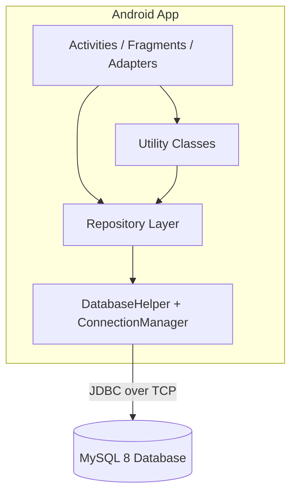
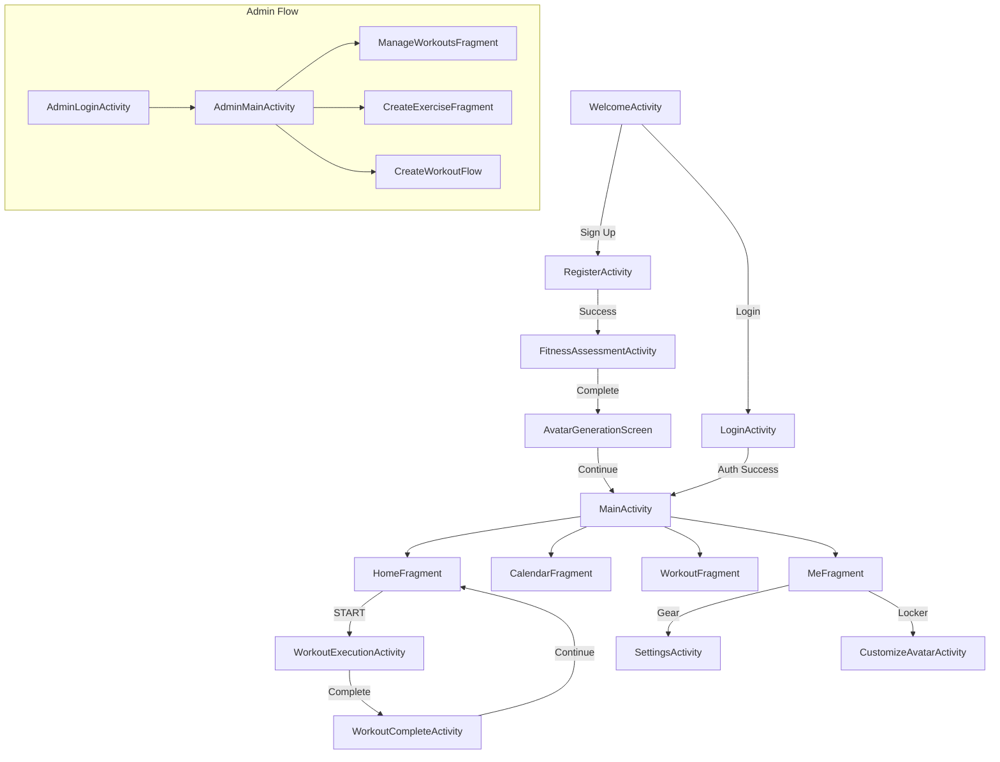
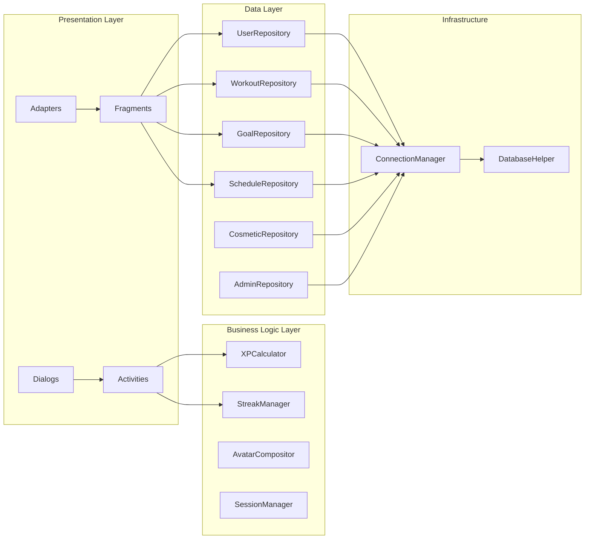
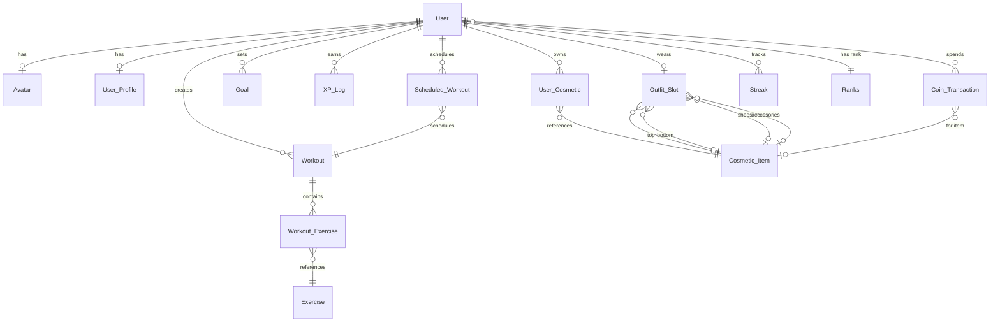

# Design Document — Reps Up App

## Overview

Reps Up is a gamified Android fitness application built with Java, XML layouts, and traditional Activities/Fragments architecture. The app connects to a MySQL 8 database via JDBC (through a background ExecutorService), and provides workout tracking, scheduling, goal management, avatar customization, and a full XP/coins/levels/ranks/streaks progression system.

The design targets Android API 26+ and uses a Repository pattern to abstract database access behind clean interfaces. All database operations execute on background threads via `ConnectionManager`, with results delivered through callbacks that post to the main thread for UI updates.

Key design decisions:
- **No REST API layer yet** — JDBC direct to MySQL (via emulator host `10.0.2.2`) for local development
- **Repository pattern** — each domain area has a dedicated repository class wrapping SQL queries
- **Callback-based async** — `ConnectionManager.DatabaseCallback<T>` for all DB operations
- **Session via SharedPreferences** — lightweight token-free auth persistence
- **Pre-rendered PNG avatar compositing** — Canvas-based layering at runtime

## Architecture

### High-Level Architecture



### Navigation Architecture



### Layer Architecture



## Components and Interfaces

### Activities

| Class | Responsibility |
|-------|---------------|
| `WelcomeActivity` | Launcher. Shows branding, Sign Up and Login buttons |
| `LoginActivity` | Username/password auth form with dark/white card split layout |
| `RegisterActivity` | Registration form with validation |
| `FitnessAssessmentActivity` | 9-step ViewPager2 wizard collecting profile data |
| `MainActivity` | Fragment host with BottomNavigationView and persistent top bar |
| `WorkoutExecutionActivity` | One-exercise-at-a-time workout logging with set tracking |
| `WorkoutCompleteActivity` | Post-workout summary screen showing XP and muscles worked |
| `SettingsActivity` | User profile management and app preferences |
| `CustomizeAvatarActivity` | Avatar locker with category tabs and live preview |
| `AdminLoginActivity` | Admin-specific authentication |
| `AdminMainActivity` | Admin portal host |

### Fragments

| Class | Responsibility |
|-------|---------------|
| `HomeFragment` | Today's workout card, next goal card, week strip |
| `CalendarFragment` | Monthly grid with indicators, "My Plan" and "Goals" tabs |
| `WorkoutFragment` | "Saved" and "Library" sub-tabs with workout/exercise browsing |
| `MeFragment` | Avatar display, rank, level progress, navigation to settings/locker |
| `GoalsListFragment` | Goal cards with completion checkbox and 3-dot menu |
| `WeeklyPlanFragment` | Collapsible weekly plan with workout cards |
| `ManageWorkoutsFragment` | Admin — search, filter, edit, delete default workouts |
| `CreateExerciseFragment` | Admin — exercise creation form |

### Repository Interfaces

```java
// UserRepository.java
public class UserRepository {
    public void authenticate(String username, String password, DatabaseCallback<User> callback);
    public void register(User user, DatabaseCallback<Long> callback);
    public void getUserById(int userId, DatabaseCallback<User> callback);
    public void updateUser(User user, DatabaseCallback<Integer> callback);
    public void updateXpAndCoins(int userId, int xpDelta, int coinDelta, DatabaseCallback<Integer> callback);
    public void updateStreak(int userId, int newStreak, DatabaseCallback<Integer> callback);
    public void updateLevel(int userId, int newLevel, DatabaseCallback<Integer> callback);
    public void updateRank(int userId, int newRankId, DatabaseCallback<Integer> callback);
    public void isUsernameTaken(String username, DatabaseCallback<Boolean> callback);
    public void saveProfile(UserProfile profile, DatabaseCallback<Long> callback);
    public void getProfile(int userId, DatabaseCallback<UserProfile> callback);
}

// WorkoutRepository.java
public class WorkoutRepository {
    public void getUserWorkouts(int userId, DatabaseCallback<List<Workout>> callback);
    public void getDefaultWorkouts(DatabaseCallback<List<Workout>> callback);
    public void getWorkoutWithExercises(int workoutId, DatabaseCallback<Workout> callback);
    public void createWorkout(Workout workout, List<WorkoutExercise> exercises, DatabaseCallback<Long> callback);
    public void updateWorkout(Workout workout, List<WorkoutExercise> exercises, DatabaseCallback<Integer> callback);
    public void duplicateWorkout(int workoutId, DatabaseCallback<Long> callback);
    public void deleteWorkout(int workoutId, DatabaseCallback<Integer> callback);
    public void getExercisesByMuscleGroup(String muscleGroup, DatabaseCallback<List<Exercise>> callback);
    public void getAllExercises(DatabaseCallback<List<Exercise>> callback);
    public void createExercise(Exercise exercise, DatabaseCallback<Long> callback);
    public void searchWorkoutsByName(String query, DatabaseCallback<List<Workout>> callback);
}

// GoalRepository.java
public class GoalRepository {
    public void getUserGoals(int userId, DatabaseCallback<List<Goal>> callback);
    public void getNextGoal(int userId, DatabaseCallback<Goal> callback);
    public void createGoal(Goal goal, DatabaseCallback<Long> callback);
    public void updateGoal(Goal goal, DatabaseCallback<Integer> callback);
    public void completeGoal(int goalId, DatabaseCallback<Integer> callback);
    public void deleteGoal(int goalId, DatabaseCallback<Integer> callback);
}

// ScheduleRepository.java
public class ScheduleRepository {
    public void getTodaysWorkout(int userId, DatabaseCallback<ScheduledWorkout> callback);
    public void getScheduledWorkoutsForMonth(int userId, int year, int month, DatabaseCallback<List<ScheduledWorkout>> callback);
    public void getScheduledWorkoutsForWeek(int userId, Date weekStart, DatabaseCallback<List<ScheduledWorkout>> callback);
    public void scheduleWorkout(ScheduledWorkout scheduled, String repeatInterval, DatabaseCallback<Long> callback);
    public void completeScheduledWorkout(int schedId, int earnedXp, int sets, int reps, DatabaseCallback<Integer> callback);
    public void getScheduledContentForDay(int userId, Date date, DatabaseCallback<List<ScheduledWorkout>> callback);
}

// CosmeticRepository.java
public class CosmeticRepository {
    public void getUserCosmetics(int userId, DatabaseCallback<List<CosmeticItem>> callback);
    public void getOwnedCosmetics(int userId, DatabaseCallback<List<CosmeticItem>> callback);
    public void getLockedCosmetics(int userId, DatabaseCallback<List<CosmeticItem>> callback);
    public void unlockCosmetic(int userId, int cosmeticId, DatabaseCallback<Integer> callback);
    public void equipCosmetic(int userId, int cosmeticId, DatabaseCallback<Integer> callback);
    public void getOutfitSlot(int userId, DatabaseCallback<OutfitSlot> callback);
    public void saveOutfitSlot(OutfitSlot slot, DatabaseCallback<Integer> callback);
}

// AdminRepository.java
public class AdminRepository {
    public void authenticate(String username, String password, DatabaseCallback<Boolean> callback);
}
```

### Utility Classes

```java
// XPCalculator.java
public class XPCalculator {
    /**
     * Calculates XP earned from completing a workout.
     * Formula: sum(base_xp * sets_completed per exercise) * streak_multiplier
     */
    public static int calculateWorkoutXP(List<ExerciseResult> results, double streakMultiplier);

    /**
     * Returns XP for completing a goal based on priority.
     * Top=1000, Medium=500, Low=250
     */
    public static int calculateGoalXP(String priority);

    /**
     * Determines the XP threshold needed for the next level.
     * Level N requires N * 100 XP to advance to N+1.
     */
    public static int xpForNextLevel(int currentLevel);

    /**
     * Checks if total XP exceeds the threshold for the next level.
     */
    public static boolean shouldLevelUp(int totalXp, int currentLevel);
}

// StreakManager.java
public class StreakManager {
    /**
     * Evaluates yesterday's completion status and returns the new streak value.
     * - Yesterday scheduled AND completed → streak + 1
     * - Yesterday scheduled AND NOT completed → streak = 0
     * - Yesterday NOT scheduled (rest day) → streak unchanged
     */
    public static int evaluateStreak(int currentStreak, boolean hadScheduledWorkout, boolean completedYesterday);

    /**
     * Returns the XP multiplier for a given streak count.
     * Every 14 days: multiplier increases (1.0 base, 1.5 at 14, increasing every 14 after).
     */
    public static double getMultiplier(int streakCount);

    /**
     * Returns true if the streak count is a 14-day milestone (14, 28, 42, ...).
     */
    public static boolean isMilestone(int streakCount);
}

// AvatarCompositor.java
public class AvatarCompositor {
    /**
     * Composites avatar layers into a single Bitmap.
     * Layers: base body → top → bottom → shoes → accessories
     */
    public static Bitmap composite(Context context, Avatar avatar, OutfitSlot outfit);

    /**
     * Returns the resource ID for the base body image given gender and body type.
     */
    public static int getBaseBodyResource(String gender, String bodyType);
}

// SessionManager.java
public class SessionManager {
    public void createSession(int userId, String username);
    public boolean hasActiveSession();
    public int getUserId();
    public String getUsername();
    public void clearSession();
    public boolean isAdmin();
    public void setAdmin(boolean isAdmin);
}
```

### Adapters

| Class | Responsibility |
|-------|---------------|
| `WorkoutCardAdapter` | RecyclerView adapter for workout cards (blue border, exercise preview) |
| `ExerciseListAdapter` | RecyclerView adapter for exercise items in library/selection |
| `GoalCardAdapter` | RecyclerView adapter for goal cards (red border, priority badge) |
| `WeeklyPlanAdapter` | RecyclerView adapter for collapsible weekly plan sections |
| `CosmeticGridAdapter` | GridView adapter for locker items (owned vs locked overlay) |
| `SetLogAdapter` | RecyclerView adapter for set rows during workout execution |
| `MuscleGroupGridAdapter` | GridView adapter for muscle group selection |

### Dialogs

| Class | Responsibility |
|-------|---------------|
| `LevelUpDialog` | Blurred overlay, bicep icon, new level, "+50 COINS" |
| `RankUpDialog` | Medal image, rank name, "+100 COINS", Share/Close |
| `StreakMilestoneDialog` | Fire icon, streak count, XP multiplier, Share/Close |
| `GoalCompleteDialog` | "CONGRATULATIONS!", goal title, XP earned, Share/Close |
| `WorkoutCompleteDialog` | "GREAT WORKOUT!", XP earned, muscles worked |
| `ConfirmDialog` | Generic confirmation (delete, logout) with Cancel/Confirm |
| `PurchaseDialog` | Cosmetic item image, price, Cancel/Buy |

## Data Models

The data layer maps to 16 MySQL tables. All model classes exist in `com.jve.repsup.models`.

### Entity-Relationship Diagram



### Table-to-Model Mapping

| MySQL Table | Java Model | Key Fields |
|-------------|-----------|------------|
| `User` | `User` | user_id, first_name, email, username, set_password, xp, coins, current_level, rank_id, current_streak, avatar_id, measurment_system, set_language |
| `Avatar` | `Avatar` | avatar_id, user_id, skin_tone, body_shape, facial_details |
| `User_Profile` | `UserProfile` | profile_id, user_id, user_gender, user_age, user_weight, user_height, body_type, workout_lvl, num_workouts_per_week, fitness_goal |
| `Ranks` | `Rank` | rank_id, tier, subtier, min_lvl_required |
| `Exercise` | `Exercise` | exercise_id, exercise_name, muscle_group, default_sets, default_reps, difficulty, base_xp |
| `Workout` | `Workout` | workout_id, user_id, workout_name, is_default, workout_order_index |
| `Workout_Exercise` | `WorkoutExercise` | workout_id, exercise_id, num_sets, num_reps, workout_exercise_order_index |
| `Scheduled_Workout` | `ScheduledWorkout` | scheduled_workout_id, user_id, workout_id, scheduled_date, is_completed, completed_date, earned_xp, completed_sets, completed_reps |
| `Goal` | `Goal` | goal_id, user_id, goal_description, deadline, goal_priority, is_completed, completed_at |
| `XP_Log` | `XPLog` | log_id, user_id, amount, source_type, source_id, xp_earned, coins_earned, time_stamp |
| `Coin_Transaction` | `CoinTransaction` | transaction_id, user_id, amount, cosmetic_id |
| `Cosmetic_Item` | `CosmeticItem` | cosmetic_id, cosmetic_name, cosmetic_type, unlock_type, lvl_required, coin_cost, cosmetic_img_data |
| `User_Cosmetic` | `UserCosmetic` | user_cosmetic_id, user_id, cosmetic_id, is_unlocked, is_equipped |
| `Outfit_Slot` | `OutfitSlot` | outfit_slot_id, user_id, top_id, bottom_id, shoes_id, accessories_id |
| `Streak` | `Streak` | streak_id, user_id, week_st_date, num_workouts_completed, met_goal, multiplier |
| `Admins` | (inline in AdminRepository) | admin_id, admin_username, admin_password |

### Additional Models Needed

```java
// ExerciseResult.java — transient model for workout execution results
public class ExerciseResult {
    private int exerciseId;
    private int baseXp;
    private int setsCompleted;
    private int totalReps;
    private double totalWeight;
}

// OutfitSlot.java — maps to Outfit_Slot table
public class OutfitSlot {
    private int outfitSlotId;
    private int userId;
    private Integer topId;
    private Integer bottomId;
    private Integer shoesId;
    private Integer accessoriesId;
}

// UserCosmetic.java — maps to User_Cosmetic table
public class UserCosmetic {
    private int userCosmeticId;
    private int userId;
    private int cosmeticId;
    private boolean isUnlocked;
    private boolean isEquipped;
}

// CoinTransaction.java — maps to Coin_Transaction table
public class CoinTransaction {
    private int transactionId;
    private int userId;
    private int amount;
    private Integer cosmeticId;
}
```

## Correctness Properties

*A property is a characteristic or behavior that should hold true across all valid executions of a system — essentially, a formal statement about what the system should do. Properties serve as the bridge between human-readable specifications and machine-verifiable correctness guarantees.*

### Property 1: XP Calculation is Non-Negative and Monotonic

*For any* list of exercise results (each with base_xp >= 0 and sets_completed >= 0) and any streak multiplier >= 1.0, the computed workout XP SHALL be non-negative and SHALL increase monotonically as any individual exercise's sets_completed increases.

**Validates: Requirements 15.2, 17.1**

### Property 2: Goal XP Matches Priority Mapping

*For any* goal priority value in {Top, Medium, Low}, the XP awarded SHALL be exactly 1000, 500, or 250 respectively, and for any other priority value the XP SHALL be 0.

**Validates: Requirements 8.5, 17.2**

### Property 3: Streak Evaluation is Deterministic and Correct

*For any* current streak count >= 0, the streak evaluation SHALL:
- Return streak + 1 when a workout was scheduled AND completed yesterday
- Return 0 when a workout was scheduled AND NOT completed yesterday
- Return the unchanged streak when no workout was scheduled yesterday (rest day)

**Validates: Requirements 16.1, 16.2, 16.3**

### Property 4: Streak Multiplier Increases at 14-Day Intervals

*For any* streak count >= 0, the XP multiplier SHALL be 1.0 for streaks < 14, and SHALL be >= 1.5 for streaks >= 14, with the multiplier non-decreasing as streak count increases.

**Validates: Requirements 16.5**

### Property 5: Streak Milestones Occur at Exact Multiples of 14

*For any* positive integer streak count, `isMilestone(streak)` SHALL return true if and only if streak is a positive multiple of 14.

**Validates: Requirements 16.4**

### Property 6: Level-Up Threshold is Deterministic

*For any* current level >= 1 and total XP >= 0, `shouldLevelUp` returns true if and only if totalXp >= sum of (level * 100) for levels 1 through currentLevel. The level-up check is idempotent — calling it twice with the same inputs produces the same result.

**Validates: Requirements 18.1**

### Property 7: Coin Balance Invariant on Cosmetic Purchase

*For any* user with coins >= item cost, after purchasing a cosmetic item, the user's new coin balance SHALL equal the previous balance minus the item's coin cost. If coins < item cost, the balance SHALL remain unchanged.

**Validates: Requirements 22.2, 22.3**

### Property 8: Workout Exercise Count Bounded

*For any* workout creation attempt, the system SHALL accept exactly 1 to 8 exercises. For any count outside this range, the creation SHALL be rejected and no Workout record created.

**Validates: Requirements 12.4, 25.4**

### Property 9: Registration Validation Rejects Invalid Inputs

*For any* registration attempt where username is already taken OR password != confirm password OR any required field is empty, the system SHALL reject the registration and no User record SHALL be inserted.

**Validates: Requirements 3.2, 3.3, 3.4**

## Error Handling

### Database Errors

| Scenario | Handling |
|----------|----------|
| Connection failure | Display user-friendly error via Snackbar/Toast. Do not crash. Offer retry. |
| Query timeout | Cancel operation, notify user, allow retry |
| Duplicate key (username/email) | Map to specific validation error message |
| Foreign key violation | Log error, display generic "operation failed" message |

### Input Validation Errors

| Scenario | Handling |
|----------|----------|
| Empty required field | Highlight field with red border, show inline error text |
| Password mismatch | Show error below confirm field |
| Invalid email format | Show format hint below email field |
| Exercise limit exceeded (>8) | Show Toast notification, prevent addition |
| Insufficient coins | Show "Not enough coins" in dialog, disable Buy button |

### Business Logic Errors

| Scenario | Handling |
|----------|----------|
| Workout not scheduled today | Disable START button, show "Not scheduled" state |
| Session expired/invalid | Clear session, redirect to LoginActivity |
| Avatar asset missing | Fall back to default silhouette |

### Threading Safety

- All `ConnectionManager` callbacks arrive on the background thread — repositories MUST post results to the main thread via `runOnUiThread()` or a Handler
- UI references in callbacks must use WeakReference or lifecycle checks to avoid leaks
- ExecutorService uses a fixed pool of 4 threads — sufficient for typical concurrent operations

## Testing Strategy

### Unit Tests (JUnit 5)

Focus areas:
- **XPCalculator** — verify formulas with concrete examples (0 sets, 1 exercise, max exercises, multiplier edge cases)
- **StreakManager** — verify state transitions for all three scenarios
- **Input validation** — email format, password matching, empty field detection
- **Goal.getXpReward()** — verify priority-to-XP mapping
- **Model mapping** — verify ResultSet-to-model conversion in repositories (using mocked ResultSet)

### Property-Based Tests (jqwik)

The project will use [jqwik](https://jqwik.net/) as the property-based testing library for Java.

Configuration:
- Minimum 100 iterations per property test
- Each test tagged with a comment referencing the design property

Properties to implement:
- **Feature: reps-up-app, Property 1**: XP calculation non-negative and monotonic
- **Feature: reps-up-app, Property 2**: Goal XP matches priority mapping
- **Feature: reps-up-app, Property 3**: Streak evaluation deterministic and correct
- **Feature: reps-up-app, Property 4**: Streak multiplier increases at 14-day intervals
- **Feature: reps-up-app, Property 5**: Streak milestones at multiples of 14
- **Feature: reps-up-app, Property 6**: Level-up threshold deterministic
- **Feature: reps-up-app, Property 7**: Coin balance invariant on purchase
- **Feature: reps-up-app, Property 8**: Workout exercise count bounded [1, 8]
- **Feature: reps-up-app, Property 9**: Registration validation rejects invalid inputs

### Integration Tests

- **Database connectivity** — verify ConnectionManager can execute queries against test database
- **Repository CRUD** — test full insert/query/update/delete cycles per repository
- **Navigation flows** — Espresso tests for login → home, register → assessment → home
- **Workout execution flow** — start → log sets → complete → XP awarded

### UI Tests (Espresso)

- Navigation: tab switching preserves fragment state
- Form validation: error messages appear on invalid input
- Dialogs: LevelUp, RankUp, StreakMilestone render with correct data
- Dark theme: verify background colors and text contrast

### Test Dependencies

Add to `app/build.gradle`:
```groovy
testImplementation 'net.jqwik:jqwik:1.9.1'
testImplementation 'org.junit.jupiter:junit-jupiter:5.10.2'
testImplementation 'org.mockito:mockito-core:5.11.0'
androidTestImplementation 'androidx.test.espresso:espresso-core:3.5.1'
androidTestImplementation 'androidx.test.ext:junit:1.1.5'
```
