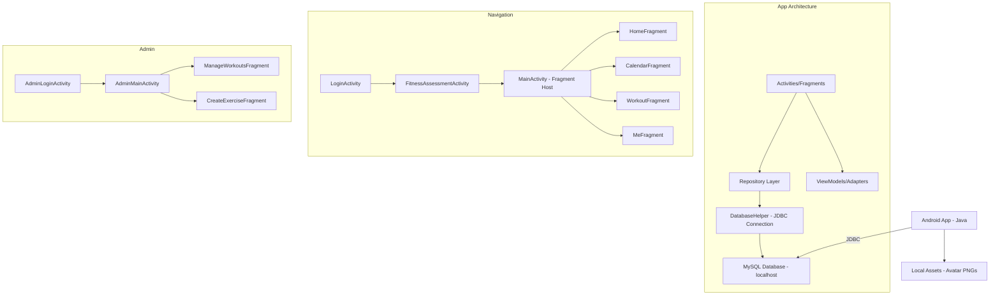

---

```markdown
# Implementation Plan — Reps Up

## Problem Statement
Reps Up is a gamified Android fitness app that needs to be built from a bare `MainActivity` to a fully functional application covering authentication, workout management, scheduling, goals, gamification (XP/coins/streaks/ranks), and avatar customization. The team of 3 is behind the BOC schedule (today is 31 July 2026) and needs to catch up on ~30 use cases before integration begins in September.

## Requirements
- Android (Java) app connecting to MySQL via JDBC (local dev, shared DB later)
- No hardcoded database credentials — use `local.properties` + `BuildConfig`
- Dark theme UI matching designs (background `#393944`, accent `#B2D6FD`, highlights red/yellow)
- Pre-rendered PNG avatar system with layered compositing
- Bottom navigation: Home, Calendar, Workout, Me
- Admin portal (separate login flow for Dean) for managing default workouts/exercises
- Gamification: XP, coins, levels, ranks, streaks with milestone popups

## Architecture



## Database Credential Approach
- Each developer adds to `android/local.properties`:
  ```
  db.host=10.0.2.2
  db.port=3306
  db.user=root
  db.password=yourPasswordHere
  db.name=reps_up
  ```
  (Note: `10.0.2.2` is how the Android emulator reaches the host machine's `localhost`)
- `app/build.gradle` reads these and injects them as `BuildConfig` fields
- `DatabaseHelper.java` uses `BuildConfig.DB_HOST`, `BuildConfig.DB_PASSWORD`, etc.
- `local.properties` is already gitignored

## Project Package Structure
```
com.jve.repsup/
├── activities/          (LoginActivity, RegisterActivity, FitnessAssessmentActivity, MainActivity, AdminMainActivity)
├── fragments/           (HomeFragment, CalendarFragment, WorkoutFragment, MeFragment, admin fragments)
├── adapters/            (RecyclerView adapters for workouts, exercises, goals, cosmetics)
├── models/              (User, Workout, Exercise, Goal, Rank, CosmeticItem, etc.)
├── repositories/        (UserRepository, WorkoutRepository, GoalRepository, etc.)
├── database/            (DatabaseHelper, ConnectionManager)
├── utils/               (XPCalculator, StreakManager, AvatarCompositor, SessionManager)
└── dialogs/             (LevelUpDialog, RankUpDialog, StreakDialog, ConfirmDialog)
```

## BOC Ownership

### James Ford
| Use Case | Name |
|----------|------|
| C300 | Create Default Workout |
| C400 | Create Default Exercise |
| C500 | Manage Default Workout |
| B100 | View Home Page |
| B221 | Set Goal |
| B220 | View Goals |
| B222 | Complete Goal |
| C113 | Manage User Profile |
| A200 | Track Streak |
| A300 | Earn XP |
| A400 | Share Streak Milestone |

### Vincent van Niekerk
| Use Case | Name |
|----------|------|
| A000 | Login |
| A100 | Register User |
| C200 | View Workout Page |
| C210 | Create User Workout |
| C220 | Manage Workout |
| B110 | Start Workout |
| B111 | Complete Workout |
| A200 | Track Streak (shared) |
| A300 | Earn XP (shared) |
| A310 | Level Up |
| A321 | Share Rank Up |

### Emma Martin
| Use Case | Name |
|----------|------|
| A110 | Assess Fitness |
| A111 | Generate Avatar |
| B200 | View Schedule Page |
| B210 | Schedule Workout |
| B230 | Edit Calendar |
| B240 | View Weekly Plan |
| C100 | View Avatar Page |
| C110 | View Locker |
| C111 | Unlock Cosmetic |
| C112 | Customize Avatar |
| A500 | Share Completed Goal |

---

## Task Breakdown

### Phase 0: Foundation (James leads, all benefit)

#### Task 1: Project Setup & Database Connection Layer
- **Owner:** James
- **Objective:** Set up project structure, theming, JDBC dependency, and secure credential loading so all team members can build on a working foundation.
- **Implementation:**
  - Add MySQL JDBC connector dependency to `app/build.gradle`
  - Add `local.properties` reading logic in `build.gradle` to inject `BuildConfig` fields
  - Create `DatabaseHelper.java` singleton that establishes JDBC connections using BuildConfig values
  - Create `ConnectionManager.java` that wraps connections with try-with-resources patterns
  - Set up the dark theme in `res/values/themes.xml` and `colors.xml` matching the design system (`#393944`, `#B2D6FD`, `#FF5050`, `#FAD942`)
  - Add Inter font and HK Modular font to `res/font/`
  - Create base styles for buttons (light blue rounded), cards (blue/red bordered), and input fields
  - Add INTERNET permission to AndroidManifest.xml
  - Create the `models/` package with all data classes: `User`, `Exercise`, `Workout`, `WorkoutExercise`, `ScheduledWorkout`, `Goal`, `Rank`, `CosmeticItem`, `Avatar`, `Streak`, `XPLog`
- **Test:** Run the app on emulator, call `DatabaseHelper.getConnection()` — verify it connects to MySQL and can execute `SELECT 1`.
- **Demo:** App launches, connects to the local MySQL database successfully, dark theme is applied.

---

#### Task 2: Session Management & Navigation Shell
- **Owner:** James
- **Objective:** Create the authentication session system and the main navigation structure (bottom nav with 4 tabs).
- **Implementation:**
  - Create `SessionManager.java` using SharedPreferences to store logged-in user_id, username, and session state
  - Create `MainActivity.java` with BottomNavigationView (Home, Calendar, Workout, Me tabs)
  - Create empty placeholder fragments: `HomeFragment`, `CalendarFragment`, `WorkoutFragment`, `MeFragment`
  - Implement fragment switching on tab selection
  - Create the shared top bar component (avatar thumbnail, level, streak fire icon, coin count) as a reusable include layout
  - Add navigation logic: if no session → show `LoginActivity`; if session exists → show `MainActivity`
- **Test:** Launch app → redirected to Login. Manually set a session → see bottom nav with 4 tabs switching between placeholder fragments.
- **Demo:** Bottom navigation works, tab switching shows different fragments, session check redirects appropriately.

---

### Phase 1: Authentication & Onboarding

#### Task 3: Login (Vincent — A000)
- **Owner:** Vincent
- **Objective:** Build the login screen matching the UI design, authenticating against the User table.
- **Implementation:**
  - Create `LoginActivity.java` with layout: dark top half with gym image and "Welcome back!" text, white bottom card with Username/Password fields, Login button, "Don't have an account? Sign up" link
  - Create `UserRepository.java` with `authenticate(username, password)` method — queries User table via JDBC (run on background thread using `ExecutorService`)
  - On successful login: store user_id in SessionManager, navigate to MainActivity
  - On failure: show error Toast/Snackbar
  - Add "Forgot password" link (non-functional placeholder)
  - Wire "Sign Up" link to navigate to RegisterActivity
- **Test:** Login with test user "dyllan12345" → lands on Home. Wrong password → error message.
- **Demo:** Working login screen that authenticates against the database and navigates to the main app.

---

#### Task 4: Register (Vincent — A100)
- **Owner:** Vincent
- **Objective:** Build the registration flow (Welcome screen → Sign Up form) and insert new users.
- **Implementation:**
  - Create `WelcomeActivity.java` — "Welcome to REPS UP" splash with Sign Up button and "Have an account already? Login" link
  - Create `RegisterActivity.java` with form: Name, Username, Email, Password, Confirm Password, "Get Started" button
  - Input validation: all fields required, email format check, password match, username uniqueness check
  - `UserRepository.addUser(user)` — INSERT into User table with defaults (xp=0, coins=0, level=1, rank_id=1, streak=0)
  - On success: store session, navigate to FitnessAssessmentActivity
  - Set WelcomeActivity as the launcher activity
- **Test:** Register new user → appears in database. Duplicate username → error. Mismatched passwords → validation error.
- **Demo:** Full registration flow: Welcome → Sign Up → validation → user created → proceeds to fitness assessment.

---

#### Task 5: Fitness Assessment (Emma — A110)
- **Owner:** Emma
- **Objective:** Build the multi-step fitness assessment wizard (9 screens) collecting user profile data.
- **Implementation:**
  - Create `FitnessAssessmentActivity.java` hosting ViewPager2 or manual fragment switching
  - Steps:
    1. Welcome ("WELCOME [NAME]! Complete your fitness assessment") + "Let's Go"
    2. Gender (Male/Female circular buttons)
    3. Age (number picker/scroll wheel)
    4. Weight (horizontal ruler slider with kg/lbs toggle)
    5. Height (horizontal ruler slider with cm/ft toggle)
    6. Body type (6 images in 2×3 grid)
    7. Workout level (never, beginner, intermediate, advanced)
    8. Workout schedule (1–7 days/week)
    9. Goal (multi-select: Lose weight, Stay Consistent, Build muscle, Get fitter, Improve endurance)
  - Progress bar (segmented) at top
  - Back/Next buttons per step
  - Save all to `User_Profile` table on completion
  - Update User's `measurment_system` based on unit selections
- **Test:** Complete all steps → User_Profile row created. Back retains values.
- **Demo:** Full assessment flow with selectors, sliders, grids — data persisted.

---

#### Task 6: Generate Avatar (Emma — A111)
- **Owner:** Emma
- **Objective:** Generate a default avatar based on profile data, show "Meet Your Avatar" screen.
- **Implementation:**
  - Create avatar assets: `res/drawable/avatar/` with base body PNGs by gender × body type
  - Default outfit overlays: `white_tank.png`, `black_shorts.png`, `white_sneakers.png`
  - `AvatarCompositor.java` — layers base + top + bottom + shoes using Android Canvas
  - Map assessment body_type + gender → base image
  - INSERT Avatar row, INSERT default User_Cosmetic entries (items 1-3 equipped), INSERT Outfit_Slot
  - Update User.avatar_id
  - "MEET YOUR AVATAR!" screen → "Continue" → MainActivity
- **Test:** Assessment complete → avatar record created → correct image shown. Continue → Home.
- **Demo:** Avatar generated from profile, displayed, full onboarding works end-to-end.

---

### Phase 2: Admin Features (James)

#### Task 7: Admin Login & Dashboard
- **Owner:** James
- **Objective:** Separate admin login authenticating against Admins table.
- **Implementation:**
  - `AdminLoginActivity.java` — username/password, darker theme, "REPS UP" branding
  - `AdminRepository.java` authenticating against Admins table
  - `AdminMainActivity.java` with management UI
  - Admin session in SharedPreferences
  - Access via hidden entry point (long-press logo or "admin" username detection)
- **Test:** Login as "Dean" → admin dashboard. Wrong credentials → error.
- **Demo:** Admin logs in and sees management screen.

---

#### Task 8: Create Default Workout (James — C300)
- **Owner:** James
- **Objective:** Admin creates default workouts by category, muscle group, and exercise selection.
- **Implementation:**
  - Category buttons: Abdominal, Full Body, Lower Body, Upper Body
  - Category tap → muscle group grid (matching design images)
  - Muscle group tap → exercises filtered from Exercise table
  - Select exercises (max 8), highlighted in blue
  - Final screen: name workout, set reps/sets per exercise, Save
  - INSERT Workout (user_id=NULL, is_default=TRUE) + Workout_Exercise entries
- **Test:** Create default workout → Workout table with is_default=TRUE, exercises linked.
- **Demo:** Admin creates "Push Day" by selecting chest + shoulders + triceps exercises.

---

#### Task 9: Create Default Exercise (James — C400)
- **Owner:** James
- **Objective:** Admin adds new exercises to the library.
- **Implementation:**
  - Form: Exercise Name, Muscle Group (dropdown), Difficulty (Easy/Medium/Hard), Default Sets, Default Reps, Base XP, Demo image
  - Validation: name, muscle group, difficulty required
  - INSERT into Exercise table
  - Success confirmation
- **Test:** Create exercise → new row in Exercise table, visible in library.
- **Demo:** Admin adds "Dumbbell Flyes" to chest exercises.

---

#### Task 10: Manage Default Workouts (James — C500)
- **Owner:** James
- **Objective:** Admin views, searches, edits, and deletes default workouts.
- **Implementation:**
  - Search bar at top
  - Collapsible category sections → difficulty sub-sections
  - Workout cards with exercise previews
  - 3-dot menu: Edit Workout, Delete Workout
  - Edit opens Create flow pre-populated
  - Delete with confirmation dialog
- **Test:** Edit persists. Delete removes. Search filters correctly.
- **Demo:** Admin views categorized workouts, edits one, deletes another.

---

### Phase 3: Home Page & Goals (James)

#### Task 11: View Home Page (James — B100)
- **Owner:** James
- **Objective:** Main Home screen with today's workout, next goal, and user stats.
- **Implementation:**
  - `HomeFragment.java`:
    - Top bar: avatar, "Lv.X", streak 🔥 + count, coin 💰 + count
    - Week strip (S M T W T F S with dates, today highlighted)
    - "TODAY" card (blue border): workout name, date, first 3 exercises with images + sets, "and X more", START button
    - "NEXT GOAL" card (red border): deadline, title, priority badge, description, checkbox
  - `ScheduledWorkoutRepository.getTodaysWorkout(userId, today)`
  - `GoalRepository.getNextGoal(userId)`
  - Empty states for rest days / no goals
  - START → Start Workout (B110)
- **Test:** Shows correct workout and goal for today.
- **Demo:** Home displays today's workout, next goal, and user stats.

---

#### Task 12: Set Goal (James — B221)
- **Owner:** James
- **Objective:** User creates a fitness goal.
- **Implementation:**
  - Access via "+" on Calendar → "Goal" tab
  - Form: Title, Date picker, Importance (Top/Medium/Low), Notes
  - ✓ top-right to save, ← to cancel
  - INSERT into Goal table
  - Validation: Title and Date required
- **Test:** Create goal → appears in DB. Missing title → error.
- **Demo:** User creates "Bench press my body weight" with Top Priority.

---

#### Task 13: View Goals (James — B220)
- **Owner:** James
- **Objective:** Display goals in the Goals tab on Calendar page.
- **Implementation:**
  - Goals tab alongside "My Plan"
  - Cards (red border): deadline + day, title, priority badge, description, checkbox
  - 3-dot menu: Edit Goal, Delete Goal
  - Checkbox → Complete Goal (B222)
- **Test:** Goals display in order, scrollable.
- **Demo:** User sees goals with priorities, deadlines, actions.

---

#### Task 14: Complete Goal (James — B222)
- **Owner:** James
- **Objective:** Mark goal complete with XP reward and popup.
- **Implementation:**
  - Checkbox tap → UPDATE is_completed=TRUE, completed_at=NOW()
  - XP by priority: Top=1000, Medium=500, Low=250
  - INSERT XP_Log, UPDATE User.xp
  - Popup: "CONGRATULATIONS!" + bicep icon + goal title + "+XXXP"
  - Share + Close buttons
  - Check level up
- **Test:** Goal completed → DB updated, XP logged, popup shown.
- **Demo:** Tap checkbox → celebration popup with XP.

---

### Phase 4: Workout Features (Vincent — C200, C210, C220)

#### Task 15: View Workout Page (Vincent — C200)
- **Owner:** Vincent
- **Objective:** Workout tab with "Saved" and "Library" sub-tabs.
- **Implementation:**
  - `WorkoutFragment.java` with TabLayout
  - **Saved:** User's workout cards (blue border) with exercise previews
  - **Library:** Muscle group grid → exercises per group (name, difficulty, image)
  - "+" → Create Workout
  - 3-dot menu on saved cards
- **Test:** Workouts display from DB. Library shows correct exercises.
- **Demo:** Browse saved workouts and exercise library.

---

#### Task 16: Create User Workout (Vincent — C210)
- **Owner:** Vincent
- **Objective:** Create custom or generated workouts.
- **Implementation:**
  - Toggle: "Generate Workout" | "Create Workout"
  - **Create:** muscle groups → exercises (max 8) → name + reps/weight → Save
  - **Generate:** difficulty + muscle groups → system picks → review → Save
  - Validation: 1-8 exercises, name required
- **Test:** Workout + Workout_Exercise rows created.
- **Demo:** User creates "Glutes and Hamstrings" workout.

---

#### Task 17: Manage Workout (Vincent — C220)
- **Owner:** Vincent
- **Objective:** Share, edit, duplicate, reorder, delete saved workouts.
- **Implementation:**
  - 3-dot menu: Share (native intent), Edit (pre-populated), Duplicate ("Copy" suffix), Reorder (drag-drop), Delete (confirm)
- **Test:** All operations persist correctly.
- **Demo:** Duplicate, rename, reorder, delete.

---

### Phase 5: Schedule Features (Emma — B200, B210, B230, B240)

#### Task 18: View Schedule Page & Calendar (Emma — B200, B230)
- **Owner:** Emma
- **Objective:** Calendar page with monthly view and day editing.
- **Implementation:**
  - Month header with navigation arrows
  - Calendar grid: workout days = blue, goal days = red triangle, today = highlighted
  - "My Plan" | "Goals" tabs below
  - Tap day (B230) → view/edit scheduled content
  - "+" → Schedule Workout or Create Goal
- **Test:** Indicators correct. Month nav works. Day tap shows content.
- **Demo:** View September, see indicators, tap day for details.

---

#### Task 19: Schedule Workout (Emma — B210)
- **Owner:** Emma
- **Objective:** Schedule a workout on a date with optional repeat.
- **Implementation:**
  - Date picker, Repeat dropdown (Never/Weekly/Biweekly/Monthly)
  - Workout list with "+" to select
  - INSERT Scheduled_Workout; if repeat → generate future occurrences
- **Test:** Appears in DB and calendar. Repeat creates multiple entries.
- **Demo:** Schedule "Chest" every Wednesday.

---

#### Task 20: View Weekly Plan (Emma — B240)
- **Owner:** Emma
- **Objective:** Weekly plan list under "My Plan" tab.
- **Implementation:**
  - Collapsible "Week X" sections
  - Workout cards: day, name, exercises, "Completed" or "START" (today only)
- **Test:** Correct workouts shown. START only on today.
- **Demo:** Weekly plan with completed/upcoming workouts.

---

### Phase 6: Workout Execution (Vincent — B110, B111)

#### Task 21: Start Workout (Vincent — B110)
- **Owner:** Vincent
- **Objective:** Execute workout — track sets, reps, weight per exercise.
- **Implementation:**
  - `WorkoutExecutionActivity.java`: one exercise at a time
  - Large demo image, difficulty label, exercise name
  - Table: SET | REPS | KG — editable fields + checkbox per row
  - "ADD SET +" button
  - Back/Next (Next only when all sets checked)
  - Navigate by workout_exercise_order_index
  - Business rule: only start if scheduled today
- **Test:** First exercise shown. Check sets → Next enabled. Navigate all exercises.
- **Demo:** Log Bench Press sets, move to next exercise.

---

#### Task 22: Complete Workout (Vincent — B111)
- **Owner:** Vincent
- **Objective:** Completion summary with XP and muscles worked.
- **Implementation:**
  - XP = sum(base_xp × sets_completed) × streak_multiplier
  - "GREAT WORKOUT!" screen: "+XXXP", muscles worked card, avatar image, "Continue"
  - UPDATE Scheduled_Workout (completed), User (xp, coins), INSERT XP_Log
  - "Continue" → Home, check level up/streak
- **Test:** DB updated, XP correct, muscles listed.
- **Demo:** Finish workout → 400XP, Chest/Shoulders/Triceps shown.

---

### Phase 7: User Profile (James — C113)

#### Task 23: Manage User Profile (James — C113)
- **Owner:** James
- **Objective:** Settings with personal details, account, preferences, logout.
- **Implementation:**
  - Gear icon on Me page → `SettingsActivity.java`
  - User section: Personal Details, Account
  - Application section: Measurement System, Language
  - Log out → confirmation dialog → clear session → WelcomeActivity
- **Test:** Changes persist. Log out clears session.
- **Demo:** Change measurement, log out with confirmation.

---

### Phase 8: Gamification (James — A200, A300 | Vincent — A310)

#### Task 24: Track Streak (James — A200)
- **Owner:** James
- **Objective:** Streak increment/reset logic with milestone popups.
- **Implementation:**
  - `StreakManager.java`: yesterday scheduled + completed → increment. Scheduled + missed → reset. Rest day → unchanged.
  - Every 14 days → XP multiplier (1.5x, increases every 2 weeks)
  - Update User.current_streak, Streak table
  - Milestone popup: fire icon, "X DAY STREAK", "x1.5XP", share/close
- **Test:** 14-day streak → popup + multiplier. Miss → reset.
- **Demo:** 14th day → milestone popup.

---

#### Task 25: Earn XP (James — A300)
- **Owner:** James
- **Objective:** XP calculation and awarding from workouts and goals.
- **Implementation:**
  - `XPCalculator.java`:
    - Workout: sum(base_xp × sets) × streak_multiplier
    - Goal: Top=1000, Medium=500, Low=250
  - INSERT XP_Log, UPDATE User.xp and User.coins
  - Called from Complete Workout (B111) and Complete Goal (B222)
- **Test:** XP calculated correctly with multiplier applied.
- **Demo:** Complete workout → correct XP awarded considering streak multiplier.

---

#### Task 26: Level Up & Earn Coins (Vincent — A310, A311)
- **Owner:** Vincent
- **Objective:** Level progression, coin rewards on level up.
- **Implementation:**
  - Level thresholds (e.g., Level N requires N×100 XP to next level)
  - After XP earned → check if threshold met → level up
  - `LevelUpDialog.java`: blurred overlay, bicep icon, "LEVEL X", "+50 COINS"
  - UPDATE User.current_level, User.coins += 50
  - Check rank up
- **Test:** Enough XP → level up, coins awarded, popup shown.
- **Demo:** Level up popup with coin reward.

---

#### Task 27: Rank Up (Vincent — A320)
- **Owner:** Vincent
- **Objective:** Rank promotion when hitting rank-up levels.
- **Implementation:**
  - After level up → check Ranks.min_lvl_required for next rank
  - If met: UPDATE User.rank_id
  - `RankUpDialog.java`: "CONGRATULATIONS! NEW RANK UNLOCKED", medal image, rank name, "+100 COINS"
  - Share + Close buttons
- **Test:** Reach level 5 → Bronze II popup, rank_id updated.
- **Demo:** Rank up to Bronze II with bonus coins.

---

### Phase 9: Avatar & Locker (Emma — C100, C110, C111, C112)

#### Task 28: View Avatar Page (Emma — C100)
- **Owner:** Emma
- **Objective:** "Me" tab showing avatar, name, rank, level.
- **Implementation:**
  - `MeFragment.java`: top bar, large composited avatar, gear icon → Settings
  - Bottom card: "GYM RANK" with medal + rank name, bicep + "LEVEL X" with circular progress
  - Locker icon → Customize screen
- **Test:** Correct rank, level, avatar displayed.
- **Demo:** Avatar with Bronze II and Level 10.

---

#### Task 29: View Locker & Customize Avatar (Emma — C110, C112)
- **Owner:** Emma
- **Objective:** Browse cosmetics and equip them with live preview.
- **Implementation:**
  - `CustomizeAvatarActivity.java`: avatar top, coin balance
  - Tabs: Body (skin tone + body type), Face, Hair, Clothing
  - Owned items fully shown, locked items with price overlay
  - Tap owned → equip, avatar updates live via AvatarCompositor
  - ✓ to save, ← to cancel
  - UPDATE User_Cosmetic.is_equipped, Outfit_Slot
- **Test:** Equip → preview updates. Save → DB updated.
- **Demo:** Change skin tone, equip different top, save.

---

#### Task 30: Unlock Cosmetic (Emma — C111)
- **Owner:** Emma
- **Objective:** Purchase locked items with coins.
- **Implementation:**
  - Tap locked item → dialog: image, price, Cancel/Buy
  - Check coin balance. If enough: deduct, unlock
  - UPDATE User_Cosmetic.is_unlocked, User.coins, INSERT Coin_Transaction
  - Insufficient → "Not enough coins" message
- **Test:** Buy with coins → unlocked, deducted, logged. No coins → error.
- **Demo:** Buy Pink T-Shirt for 50 coins.

---

### Phase 10: Share Features & Integration

#### Task 31: Share Streak Milestone (James — A400)
- **Owner:** James
- **Objective:** Share streak milestone via native share sheet.
- **Implementation:**
  - Share button on streak popup → Android share intent
  - Text: "🔥 X DAY STREAK on Reps Up! XP Multiplier: x1.5"
  - Opens system share sheet (WhatsApp, Instagram, Notes, etc.)
- **Test:** Share intent fires with correct text.
- **Demo:** Tap share → system share sheet appears.

---

#### Task 32: Share Rank Up (Vincent — A321)
- **Owner:** Vincent
- **Objective:** Share rank up via native share sheet.
- **Implementation:**
  - Share button on rank up popup → share intent
  - Text: "🏅 Just ranked up to [RANK] on Reps Up! +100 Coins"
- **Test:** Share intent with correct rank info.
- **Demo:** Tap share on rank popup → share sheet.

---

#### Task 33: Share Completed Goal (Emma — A500)
- **Owner:** Emma
- **Objective:** Share completed goal via native share sheet.
- **Implementation:**
  - Share button on goal completion popup → share intent
  - Text: "✅ Completed: [Goal Title] on Reps Up! +XXXP"
- **Test:** Share intent with goal info.
- **Demo:** Tap share on goal popup → share sheet.

---

### Phase 11: Integration & Testing (All — September)

#### Task 34: Integration Testing & Polish
- **Owner:** All
- **Objective:** Wire all features together, test end-to-end flows, fix bugs, polish UI.
- **Implementation:**
  - Test complete user journey: Register → Assess → Home → Schedule → Start Workout → Complete → XP → Level Up → Rank Up
  - Test admin journey: Login → Create Exercise → Create Workout → Manage
  - Test edge cases: streak reset, insufficient coins, max 8 exercises, password validation
  - Connect to shared database for team testing
  - UI polish: animations, loading states, error handling
  - Performance: ensure JDBC calls don't block UI thread
- **Test:** All use cases pass end-to-end. No crashes on happy path or error paths.
- **Demo:** Complete app walkthrough from onboarding to level up.
```

---